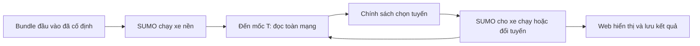

# Thiết kế mới: SUMO trực tiếp và so sánh ba chính sách định tuyến

Ngày: 28/10/2026. Trạng thái: dự thảo kế hoạch, chưa triển khai ứng dụng.

Bản này thay thế định hướng đánh giá trong `2026-10-28-sumo-aco-design.md` và kế hoạch đi kèm. Giữ tài liệu cũ để tham khảo; không tiếp tục triển khai chúng song song với bản mới.

## 1. Mục tiêu dễ hiểu

SUMO mô phỏng xe trên mạng đường đã chọn. Hệ thống đọc tình trạng các đoạn đường theo chu kỳ T do người dùng nhập, tính lại đường đi cho một xe, đưa tuyến đó trở lại SUMO và hiển thị trạng thái thật của phiên mô phỏng trên web.

Câu hỏi nghiên cứu là: với cùng điều kiện đầu vào, ACO thích nghi đạt kết quả thế nào so với Dijkstra thích nghi? Không đặt yêu cầu ACO phải thắng. Xe giữ tuyến ban đầu chỉ là mốc để xem việc cập nhật tuyến có ích hay không.

ACO cho một xe vẫn là ứng dụng hợp lệ. Phân phối tuyến cho nhiều xe, tối ưu tổng thời gian của cả mạng là một bài toán mở rộng, chưa thực hiện trong kế hoạch này.

## 2. Điều giữ lại và điều thay đổi

| Nội dung | Quyết định trong bản mới |
|---|---|
| Nguồn số liệu đường | SUMO đang chạy, đọc bằng TraCI; web không tự sinh tốc độ/số xe |
| Chu kỳ | T do người dùng nhập, tính bằng giây mô phỏng; không mặc định bắt buộc 180 giây |
| Phạm vi mạng | Toàn bộ mạng SUMO đang chọn; kiểm chứng trước trên map2 |
| Nhu cầu xe nền | Chuẩn bị lịch ngẫu nhiên có seed, có giai đoạn thêm xe qua một đoạn dài |
| Đối chứng chính | Dijkstra thích nghi, dùng cùng mục tiêu chi phí với ACO |
| Mốc phụ | Tuyến ngắn nhất theo khoảng cách, giữ nguyên suốt chuyến |
| Xe đánh giá | Đề xuất: ba lượt riêng, mỗi lượt đúng một xe đánh giá và nhiều xe nền |
| Kết quả | Đo chuyến đi thực, chất lượng tuyến và thời gian tính; không ép ACO thắng |

Việc chạy ba lượt riêng, chạy nền trước một T và các giá trị thử nghiệm bên dưới là đề xuất kỹ thuật của người lập kế hoạch, chưa phải yêu cầu người dùng đã xác nhận từng chi tiết.

## 3. Hiện trạng code và phần tái sử dụng

- `scripts/osm/osm_runner.py` đã chạy SUMO, đọc TraCI và gọi ACO trong phiên, nhưng còn sinh thêm xe ACO định kỳ và giải từ OD ban đầu; không dùng nguyên vòng này cho thí nghiệm mới.
- Tái sử dụng `dijkstra_osm` và `OSMAntColonyOptimizer` trong `scripts/core/osm_graph.py`. Thêm RNG tùy chọn cho lõi kiến, giữ tương thích các caller cũ.
- `OSMTrafficGraph` hiện gộp cạnh theo cặp nút và chưa giữ đầy đủ hạn chế rẽ. Luồng mới cần adapter theo mã đoạn SUMO, không viết lại hai thuật toán.
- ACO hiện mặc định dùng nghiệm Dijkstra làm nghiệm tốt nhất ban đầu. Thí nghiệm độc lập phải đặt `seed_with_dijkstra=False`.
- `web/js/app.js` hiện gọi `RealRoadEngine`, OSRM và chuyển động JavaScript. Máy chủ hiện chủ yếu phục vụ file; chưa có cầu nối trạng thái SUMO trực tiếp.
- Các file output/dense đang có trong workspace không phải kết quả của kế hoạch này. Không ghi đè, xóa hoặc khôi phục chúng.

## 4. Các phương án đã cân nhắc

1. **Ba xe đánh giá chạy chung một phiên:** dễ nhìn đồng thời nhưng chúng ảnh hưởng lẫn nhau, có thể tranh chỗ chèn xe và thay đổi hàng đợi của đối chứng.
2. **Ba lượt riêng có đầu vào ghép cặp — đề xuất chọn:** mỗi lượt một xe, cùng lịch xe nền và thiết lập. Tốn ba lượt mô phỏng, đổi lại dễ diễn giải và phù hợp bước đầu một xe.
3. **Chỉ so tuyến trên dữ liệu lưu sẵn:** so thuật toán trên cùng dữ liệu rất rõ, nhưng không đo được tác động đổi tuyến lên chuyến đi đang chạy. Dùng như phép đo bổ sung, không thay luồng trực tiếp.

Thứ tự triển khai: lõi định tuyến hợp lệ → lịch nhu cầu dùng lại → phiên SUMO một chính sách → bộ so sánh → web. Không mở đồng thời bài toán điều phối nhiều xe.

## 5. Ba chính sách và cùng hàm mục tiêu

- `fixed_initial`: tìm tuyến ngắn nhất theo khoảng cách một lần trước khi xe xuất phát; giữ tuyến đó đến cuối chuyến.
- `adaptive_dijkstra`: tại mỗi snapshot đầy đủ, tìm tuyến chi phí động nhỏ nhất từ vị trí hiện tại.
- `adaptive_aco`: cùng lịch cập nhật, dữ liệu và quy tắc áp tuyến; thay bộ giải Dijkstra bằng đàn kiến độc lập.

Hai chính sách thích nghi dùng cùng chi phí đoạn đường không âm:

```text
C(e) = 0,2 × D_norm + 0,3 × TT_norm + 0,3 × N_norm + 0,2 × W_norm
X_norm = min(X / bound_X, 1)
```

D là chiều dài (m), TT là thời gian đi ước tính của đoạn (s), N là số xe trên đoạn, W là chỉ số thời gian chờ của xe trên đoạn do TraCI trả về (s). W không phải dự báo riêng thời gian chờ đèn đỏ của xe mục tiêu. Chi phí C là điểm không đơn vị, không phải số giây.

Giữ chuẩn hóa của code OSM: `distance=max(1.2*max_edge_length,500)`, `travel_time=200`, `vehicles=80`, `waiting=500`. Cố định các bound cho cả ba lượt trên cùng mạng; không chuẩn hóa lại riêng theo mỗi snapshot.

Đồ thị chuyển hướng có nút là edge_id. Chuyển từ e1 sang e2 trả chi phí C(e2); chi phí tuyến dùng để quyết định là tổng trên `route[1:]`. Phần còn lại trên cạnh đang đi đã được cam kết và giống nhau giữa các tuyến ứng viên nên không quyết định lựa chọn. Báo quãng đường/ETA riêng phải tính cả phần cạnh hiện tại còn lại; ETA chỉ là ước tính.

Với cùng snapshot, cùng điểm đầu/cuối và cùng chi phí cộng không âm, Dijkstra là chuẩn chi phí tối ưu. Nếu ACO được báo có chi phí thấp hơn Dijkstra quá sai số `1e-9`, phải kiểm tra dữ liệu/cách tính, không công bố đó là chiến thắng của ACO.

Đề xuất giữ cấu hình kiến hiện có: 30 kiến, 80 vòng, alpha=1, beta=3, gamma=2, rho=0.1, Q=100, adaptive_rho=False. Mỗi lần tính tạo optimizer mới để không mang best_cost cũ sang snapshot mới; `max_steps=len(graph.nodes)`. RNG riêng theo `aco_seed + snapshot_id`, không dùng RNG của lịch xe. Bản đầu chưa giữ pheromone giữa các snapshot; “thích nghi” ở đây là tính lại với số liệu mới.

Nếu ACO không tìm được đường, tiếp tục tuyến đang đi hoặc tuyến ban đầu hợp lệ, ghi `no_solution` và `fallback_used`; không đưa nghiệm Dijkstra vào đàn kiến. Quy tắc giữ tuyến khi không cải thiện áp dụng như nhau cho hai chính sách thích nghi.

## 6. Đầu vào và lịch nhu cầu cố định cho một block

Đầu vào: mạng/cấu hình SUMO và route-file tương ứng, origin_edge, destination_edge, T, extra_flow_vph, duration_s, environment_seed, aco_seed. T là số nguyên dương và không nhỏ hơn bước SUMO; duration_s lớn hơn T; extra_flow_vph là số hữu hạn dương. Không chấp nhận bool, NaN, infinity hoặc thiếu các trường bắt buộc.

Đề xuất dùng cùng T cho giai đoạn nhu cầu và cập nhật định tuyến để giữ bản đầu gọn. Trước khi chạy bất kỳ chính sách nào:

1. Kiểm tra mạng, quyền xe con, OD nối được và lịch nền. Bản đầu nhận lịch xe explicit có giờ xuất phát và tuyến xác định; flow/trip/routeDistribution chưa được triển khai thành lịch cụ thể phải báo cần tiền xử lý, không âm thầm coi là đã cố định.
2. Chọn đoạn dài trong 25% cạnh xe con dài nhất có tuyến nền hợp lệ đi qua; giữ thứ tự edge_id ổn định. Nếu không có ứng viên, báo không thể tạo chế độ tăng nhu cầu.
3. RNG môi trường chọn mỗi giai đoạn giữa giữ nền và thêm xe, xác suất 50/50. Khi thêm, lấy tuyến nền hợp lệ đi qua đoạn đã chọn, tạo chuyến mới với ID riêng và khoảng cách yêu cầu xuất phát `3600/extra_flow_vph` giây. Lần đầu ở đầu giai đoạn; dừng trước cuối giai đoạn. Ghi rõ quy tắc này để tái lập.
4. Lưu lịch đầy đủ gồm ID, route, loại xe, requested_depart; chặn ở duration_s. Lưu sự kiện nhu cầu và hash nội dung mạng, lịch, cấu hình, trọng số. Đóng băng bundle trước lượt đầu.

Ví dụ 600 xe/giờ nghĩa là yêu cầu thêm khoảng một xe mỗi 6 giây trong giai đoạn được chọn; không phải đặt sẵn 600 xe lên đường. SUMO tự quyết định khi nào chèn được xe. Không xóa xe cũ khi đổi giai đoạn. Không có cam kết giai đoạn thêm xe chắc chắn tạo ùn tắc.

Mỗi block dùng cùng bundle cho đủ ba chính sách. Chạy SUMO sạch từng lượt, cùng seed, bước thời gian, chương trình đèn và thuộc tính xe mục tiêu (kể cả speedFactor, departLane/pos/speed); chỉ đổi chính sách. Background không được tự bật thiết bị đổi tuyến riêng ngoài cấu hình đã ghi. Override `ignore-route-errors=false`, ghi rõ `time-to-teleport=300`, chuyển mọi output sang thư mục mới.

Thời điểm yêu cầu xuất phát mục tiêu cố định trước là bước SUMO đầu tiên đạt T. Nếu lần đọc snapshot đầu lỗi, đánh dấu lượt `error`, không tự dời xuất phát riêng sang 2T. Không xếp hạng một block có lượt lỗi kỹ thuật.

## 7. Luồng một lượt mô phỏng



- Worker duy nhất sở hữu kết nối TraCI riêng. SUMO chạy từng bước; mốc cập nhật là kT theo `simulation.getTime()`, không phải số vòng lặp hoặc đồng hồ máy.
- Snapshot lấy sau một bước, đọc đủ mọi cạnh thường cho xe con. Có `snapshot_id`, `nominal_time=kT`, `traffic_time`, số xe, xe dừng, tốc độ, chờ, travel_time, nguồn/độ mới. T=37, bước 0.7 cho mốc đo 37.1, 74.2; không cộng trễ thành lịch mới.
- Tại snapshot đầu: chọn tuyến theo chính sách rồi yêu cầu đúng một xe mục tiêu xuất phát. Cùng một tuyến ngắn nhất theo khoảng cách được chuẩn bị làm dự phòng chung; sử dụng nó phải có cờ riêng. Không tự sinh thêm xe mục tiêu.
- Sau đó, mỗi snapshot đầy đủ chạy đúng một lần bộ giải đang chọn khi xe hoạt động. fixed_initial tiếp tục thu số liệu nhưng không tìm lại đường. Xe chờ chèn/đã hoàn tất/bị loại không giải từ một vị trí giả.
- Trên cạnh thường, tuyến mới phải bắt đầu bằng cạnh hiện tại và đến đúng đích. Trong giao lộ, giải từ cạnh thường kế tiếp đã cam kết và lưu pending gồm source_edge/snapshot_id; chỉ áp khi xe ở đúng source đó. Không gọi bộ giải thêm chỉ để thử áp. Snapshot mới thay pending cũ; bỏ pending nếu đã đi qua source.
- Chỉ áp tuyến hợp lệ, có chi phí thấp hơn phần tuyến đang đi trên cùng snapshot ít nhất sai số số học `1e-9`. Giữ tuyến khi bằng/kém hơn. TraCI từ chối thì giữ tuyến, ghi lý do; không che lỗi.
- Mất dữ liệu sau xuất phát: giữ tuyến và last-known, bật stale, giữ nguyên traffic_time/snapshot_id, ghi traffic_attempt_time và lỗi; chờ mốc kế tiếp. Không tạo quyết định mới từ snapshot thiếu.
- Đoạn không có xe có `observed=false`; dùng thời gian free-flow `length/max_allowed_speed` làm ước tính, N=W=0. Không gọi đây là tốc độ quan sát. Giá trị âm/sentinel/non-finite trên đoạn có xe làm snapshot không đầy đủ. Các ước tính và số đo được phân biệt trong log/API.
- Teleport được ghi `ever_teleported=true`; theo dõi xe đến khi hoàn tất/bị loại/hết thời lượng, không coi teleport tự nó là đến đích. Không tính chuyến này là hoàn thành sạch.
- Worker công bố telemetry xe sau mỗi bước; số đo đường chỉ đổi ở snapshot T. Browser polling chỉ đọc bản sao trạng thái, không chạy SUMO/thuật toán. Thời gian tính toán làm mô phỏng chờ bước, không tự cộng vào duration mô phỏng; báo solver_elapsed_ms riêng.

## 8. Hai phép đánh giá riêng

**A. Chất lượng thuật toán trên cùng bài toán.** Sau lượt mô phỏng, đọc lại snapshot đã lưu. Chạy Dijkstra và ACO trên đúng cùng snapshot/source/destination, cùng bounds và quy tắc, không áp kết quả ngược vào phiên SUMO đã xong. Lưu cost, tìm được tuyến hay không, thời gian tính bằng perf_counter, tham số và seed. Có thể dùng snapshot của từng chính sách; không gọi các mẫu của cùng một lượt là các thử nghiệm môi trường độc lập.

```text
gap_pct = 100 * (cost_ACO - cost_Dijkstra) / cost_Dijkstra
```

Chỉ tính gap khi hai nghiệm hợp lệ và cost_Dijkstra > 0. Khi cùng chi phí 0 thì gap=0; ACO lớn hơn 0 khi chuẩn bằng 0 thì gap=null và ghi lý do. Solver không tìm được đường phải có bản ghi thất bại, không gán cost=0.

**B. Hiệu quả chuyến đi.** Với mỗi lượt, lưu requested_depart, actual_depart, arrival, departDelay, duration, waitingTime, timeLoss, routeLength, số lần đổi tuyến, tỷ lệ dùng dự phòng và trạng thái. Chỉ tiêu chính cho chuyến hoàn thành sạch:

```text
elapsed_from_request_s = arrival - requested_depart = departDelay + duration
saving_pct_ACO_vs_Dijkstra = 100 * (elapsed_Dijkstra - elapsed_ACO) / elapsed_Dijkstra
```

Giữ dấu âm khi ACO chậm hơn; không dùng Math.max(0, ...). waitingTime là thời gian xe gần như đứng yên theo SUMO, không đồng nghĩa toàn bộ chậm trễ và không riêng chờ đèn đỏ. Xe chưa chèn/chưa đến đích bị ghi censored/unfinished, không có thời gian hoàn thành giả; bật `--tripinfo-output.write-unfinished` và bổ sung trạng thái pending nếu chưa có tripinfo.

Chỉ khẳng định cùng đầu vào ngoại sinh. Khi quyết định khác nhau, vị trí xe, hàng đợi và số đo về sau có thể khác; cùng seed không khiến giao thông sau điều khiển giống hệt. Phép A mới bảo đảm cùng snapshot. Trên snapshot, chi phí tối ưu cũng không bảo đảm thời gian chuyến đi tương lai tối ưu.

Đề xuất thử khói một block = ba lượt; pilot năm environment_seed = 15 lượt cho mỗi OD/cấu hình nhu cầu, seed và aco_seed được công bố trước. Đây là số thử ban đầu, không phải bảo đảm đủ bằng chứng thống kê. Báo tỷ lệ hoàn thành sạch/lỗi/teleport/unfinished trước, sau đó mean/median, độ lệch chuẩn và chênh lệch ghép cặp trên số block hợp lệ được nêu rõ. Không chọn riêng seed thắng; nghiên cứu độ nhạy nhiều aco_seed trên cùng môi trường là bước tiếp khi pilot cho thấy cần.

## 9. Lưu kết quả và hiển thị web

```text
output/comparisons/<comparison_id>/
  experiment.json
  scenarios/<seed>/manifest.json, background.rou.xml, demand_events.csv
  runs/<run_id>/metadata.json, edge_snapshots.jsonl, routing_log.csv,
                tripinfo.xml, sumo.log, result.json
  algorithm_benchmark.csv
  trip_comparison.csv
  summary.json
```

ID mới cho mỗi lần chạy, không ghi đè. Manifest ghi hash nội dung, phiên bản SUMO/Python, lệnh thực thi, chương trình đèn, T, seed và toàn bộ cấu hình thuật toán. Kết quả chưa chạy phải hiển thị chưa có dữ liệu.

Web dùng cùng lõi với CLI, có lựa chọn chính sách, A/B, T, nhu cầu thêm, thời lượng, seed, chạy một lượt hoặc một block ba lượt, dừng. Ba lượt chạy tuần tự và hiển thị tiến độ 1/3–3/3; chỉ có một xe mục tiêu của lượt hiện tại. Bảng kết quả đặt ba chính sách cạnh nhau sau khi có kết quả; không vẽ ba xe như đang chạy đồng thời.

Đề xuất bản đầu nhận A/B bằng edge_id hợp lệ trên mạng, có danh sách tìm mã; marker A/B và hình học được công bố khi SUMO đã nạp. Tiện ích click tọa độ để tự chọn đoạn gần nhất có thể bổ sung sau, không chặn phép đo cốt lõi. Tọa độ hiển thị phải chuyển từ mạng đang chạy bằng `traci.simulation.convertGeo` trong worker; không dùng offset UTM48 của map2 cho các mạng khác. Mạng không có phép chiếu địa lý vẫn chạy CLI, web phải báo không có nền địa lý phù hợp.

Màu đường là chỉ báo từ số đo: `r=clamp(mean_speed/max_allowed_speed,0,1)`, xanh r>=0.7, vàng 0.4<=r<0.7, đỏ r<0.4; chưa quan sát/lỗi dùng xám và tooltip rõ nguồn. Đây là ngưỡng hiển thị đề xuất, không phải nhãn ùn tắc đã hiệu chuẩn ngoài đường.

API tối thiểu: `GET /api/network?net_file=...` chỉ đọc topology trong project để trả mã/tên/chiều dài các cạnh xe con, giúp chọn A/B trước khi chạy; không gọi TraCI. `POST /api/start` nhận options và mode single/block; `GET /api/state`; `POST /api/stop`. start kiểm tra dữ liệu, trả 202 khi chuẩn bị nền, 400 khi đầu vào sai, 409 nếu đang chạy. Request hợp lệ không tự hủy phiên khác. state chứa comparison_id/run_id/policy/progress, sim_time/telemetry_time, traffic_time/snapshot_id/data_status, network geometry, target, route, routing_result và results. snapshot() chỉ trả bản sao dữ liệu đã publish.

Polling khoảng một giây đồng hồ để hiển thị; không phải T. Bỏ kích hoạt RealRoadEngine/OSRM, kinematics JavaScript và các nhãn giả Dijkstra/ACO trong chế độ mới. Các điều khiển TH gán sẵn mức tắc, sự cố, đèn và tua tốc độ chưa hỗ trợ không xuất hiện như chức năng hoạt động.

## 10. Tiêu chí hoàn thành và giới hạn

- Cả ba chính sách chạy được trên cùng bundle; mỗi lượt đúng một xe mục tiêu; không có nghiệm Dijkstra lẫn vào tìm kiếm ACO.
- Adapter giữ cạnh song song, chiều đi, quyền xe con và chuyển hướng hợp lệ; tuyến được SUMO chấp nhận từ vị trí thực.
- T=37 và T=90 hoạt động đúng; refresh UI không tạo thêm solve; stale/pending/junction/teleport không thành kết quả giả.
- Có phép so tuyến cùng snapshot và phép đo chuyến đi thật riêng; lưu kết quả ACO thắng, hòa, thua và thất bại đúng dấu/trạng thái.
- Kiểm chứng real-SUMO có ca đổi tuyến hợp lệ và ca giữ tuyến; kiểm tra dừng/chạy lại/đóng kết nối và không ghi đè output.
- Đo thời gian đọc toàn mạng/tính tuyến trước khi cam kết tốc độ. Chưa cam kết chạy ngang đồng hồ thực hoặc ACO luôn tìm được nghiệm trên mạng lớn.
- Bản đồ khác chỉ được coi hỗ trợ sau khi kiểm tra mạng, lịch xe và phép chiếu tương ứng; không tự ghép nhiều bản đồ.

Chưa làm: điều phối nhiều xe, dự đoán/điều khiển đèn đỏ, sự cố, API giao thông ngoài đời, hiệu chuẩn lưu lượng thật, chọn tối ưu trọng số hoặc tinh chỉnh ACO để thắng đối chứng.

## 11. Tài liệu nền

- [SUMO Randomness](https://sumo.dlr.de/docs/Simulation/Randomness.html): seed và tính lặp lại của mô phỏng.
- [SUMO TripInfo](https://sumo.dlr.de/docs/Simulation/Output/TripInfo.html): ý nghĩa duration, departDelay, waitingTime, timeLoss và kết quả chưa hoàn tất.
- [SUMO Edge Value Retrieval](https://sumo.dlr.de/docs/TraCI/Edge_Value_Retrieval.html): số liệu đoạn đường; travel time là ước tính.
- [MIT — Dijkstra](https://ocw.mit.edu/courses/6-006-introduction-to-algorithms-fall-2011/lecture-videos/lecture-16-dijkstra/), [Marco Dorigo — ACO](https://www.scholarpedia.org/article/Ant_colony_optimization): điều kiện của Dijkstra và tính tìm kiếm gần đúng của ACO.
